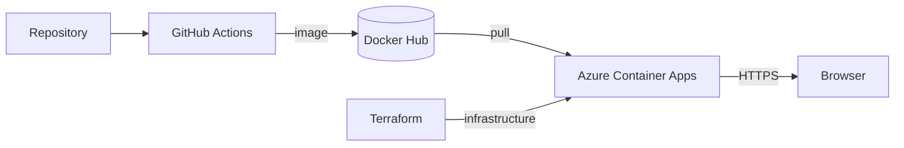

# MySimpleNetApp

[](https://github.com/blazej-stanisz/aspnet-terraform-azure-containerapps/actions/workflows/cd-dev.yml)

A small ASP.NET Core application that shows the full path from source code to a running container in
Azure: application, tests, container image, infrastructure as code and a deployment pipeline.

## Live environment

| What | Address |
|---|---|
| Application | https://ca-mysimple-dev.ashywave-e3fe58ca.polandcentral.azurecontainerapps.io |
| Swagger UI | https://ca-mysimple-dev.ashywave-e3fe58ca.polandcentral.azurecontainerapps.io/swagger/index.html |
| Metrics | https://ca-mysimple-dev.ashywave-e3fe58ca.polandcentral.azurecontainerapps.io/AppMetrics |

The environment scales to zero, so the first request after idle takes a few seconds.

## Architecture



## What it does

- Todo list stored in PostgreSQL: add a task on the page, see the list
- REST API over the same data: list, read, create, update, delete
- Swagger UI for the API
- Metrics for the running app: an in-app dashboard and a Prometheus endpoint
- Health checks for liveness and readiness
- Database status indicator on the home page
- Unit tests
- The whole stack starts with a single `docker compose up`

## Stack

| Layer | Technology |
|---|---|
| Web app | ASP.NET Core MVC, .NET 8 |
| Data | PostgreSQL 16, EF Core 8, Npgsql |
| API | ASP.NET Core controllers, Swashbuckle (OpenAPI) |
| Monitoring | prometheus-net with a small dashboard page |
| Tests | xUnit |
| Infrastructure | Terraform, remote state in Azure Storage |
| Delivery | GitHub Actions with OIDC to Azure |
| Cloud | Azure Container Apps |
| Runtime | Docker, Docker Compose |

## Docker image

The container image is published on Docker Hub, tagged with the commit SHA by the pipeline:

**https://hub.docker.com/repository/docker/blazejs/mysimplenetapp_ui/general**

## Quick start

```bash
cd MySimpleNetApp
cp .env.example .env
docker compose up -d --build
```

| What | Address |
|---|---|
| Web app | http://localhost:8080 |
| Swagger UI | http://localhost:8080/swagger |
| Metrics dashboard | http://localhost:8080/AppMetrics |
| Prometheus endpoint | http://localhost:8080/metrics |
| PostgreSQL | localhost:5432, database `todos`, user `app` |

Stop the stack with `docker compose down` (add `-v` to drop the database volume as well).

## Tests

```bash
dotnet test MySimpleNetApp/UnitTests/UnitTests.csproj
```

The command runs from the repository root and executes 27 test cases. They need no database and no network.

## API

| Method | Path | Result |
|---|---|---|
| GET | `/api/todos` | list of tasks |
| GET | `/api/todos/{id}` | single task or 404 |
| POST | `/api/todos` | 201 with the created task |
| PUT | `/api/todos/{id}` | 204 or 404 |
| DELETE | `/api/todos/{id}` | 204 or 404 |

```bash
curl -X POST https://ca-mysimple-dev.ashywave-e3fe58ca.polandcentral.azurecontainerapps.io/api/todos \
  -H "Content-Type: application/json" \
  -d '{"title":"First task"}'
```

## Notes

- The dev database is a sidecar container, so data is lost on restart, on a new revision and after scaling
  to zero.
- The API, Swagger and metrics endpoints are public. This is a demo with disposable data.
- The schema is created on startup with `EnsureCreated`, so there are no EF Core migrations yet.
